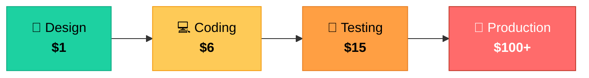
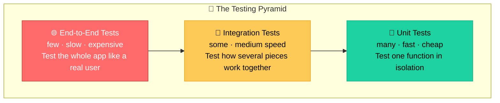
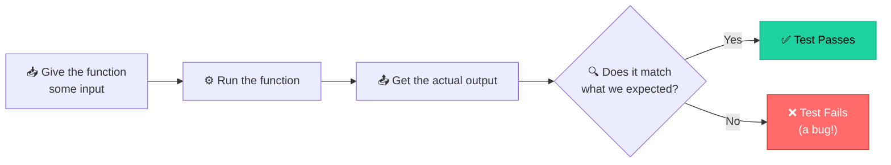
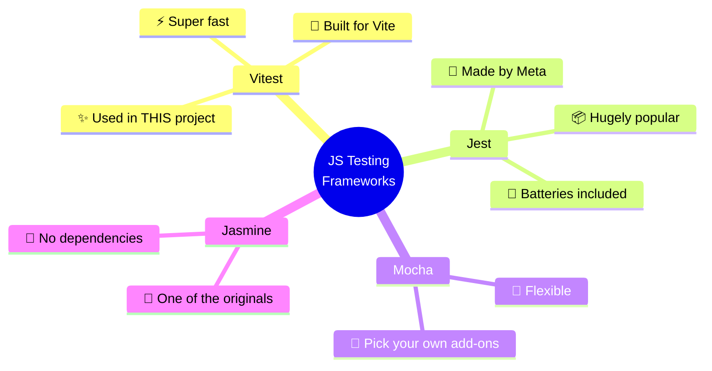
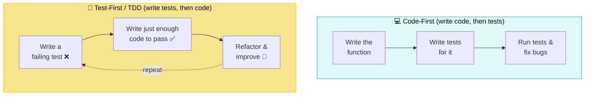
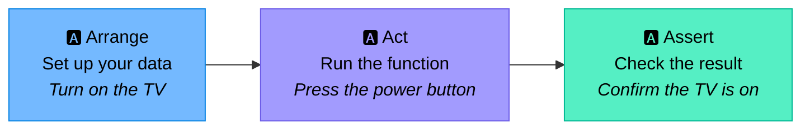
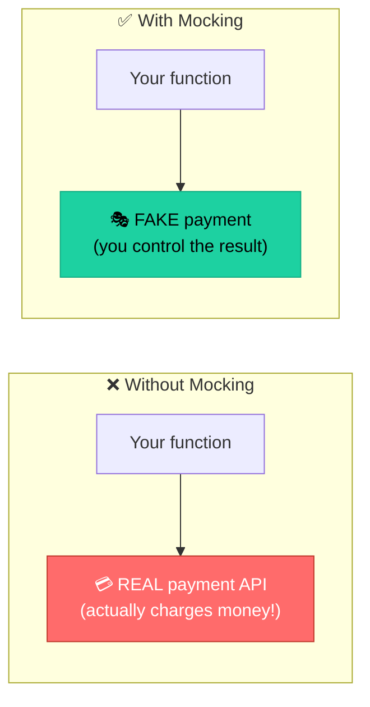

<div align="center">

# 🧪 Mastering JavaScript Unit Testing

### From "what even is a test?" → writing clean, trustworthy tests with Vitest

**A beginner-friendly field guide to unit testing — explained with analogies, diagrams, and real research.**

<br/>


<br/>


</div>

---

<div align="center">

### 💡 Why should you care about testing?

</div>

> A bug caught while you're **writing the code** costs almost nothing to fix.
> That same bug caught **in production** can cost up to **100× more.** 📈



<div align="center">

*The later a bug is found, the more expensive it gets — this is the well-known "Rule of 100."*

</div>

**The research backs it up:**

- 💸 Bugs found in production can cost **60–100× more** to fix than those caught early in design. ([CloudQA, 2025](https://cloudqa.io/how-much-do-software-bugs-cost-2025-report/) · [Testomat, 2026](https://testomat.io/blog/software-bug-cost/))
- 🛡️ Teams using automated testing consistently report **lower defect density and higher code coverage.** ([Empirical study, ResearchGate](https://www.researchgate.net/publication/370771016_An_Empirical_Study_of_the_Impact_of_Automated_Testing_on_Software_Quality))
- 🏗️ Test-Driven Development improved external code quality in **~76%** of studied cases. ([Meta-analysis, ResearchGate](https://www.researchgate.net/publication/260649027_The_Effects_of_Test-Driven_Development_on_External_Quality_and_Productivity_A_Meta-Analysis))

> *Content from the sources above was rephrased and summarized for compliance with licensing restrictions.*

---

## 📖 About This Project

This is my practice repository for learning **unit testing in JavaScript** from the ground up. I started with zero testing experience and worked through every core concept: writing my first assertion, testing edge cases, handling async code, and faking (mocking) external services.

I'm documenting it here as a learning log — both to reinforce what I learned and to show how I approach writing reliable, well-tested code.

> 🎯 **New to testing?** Read this top-to-bottom like a mini-guide.
> 👔 **Reviewing my work?** Each section maps to a real concept I practiced in the code.

---

## 🤔 First Things First: What Is Testing?

Imagine you build a vending machine. Before you let real customers use it, you'd want to check:

- Does pressing button **A1** drop the right snack?
- Does it give correct change?
- What happens if someone pays too little?

**Testing is exactly that**, checking that your code does what it's supposed to do *before* real users run into problems.

The old way is **manual testing**: run the app, click around, and eyeball the result every single time you change something. That's slow, boring, and easy to get wrong. **Automated testing** writes that checking as code, so a computer does it for you in seconds, every time, without ever getting tired.

---

## 🏛️ The Three Types of Testing

Not all tests are the same. They sit at different "zoom levels", from checking one tiny function to checking the whole app the way a real user would. This is often drawn as the **Testing Pyramid**:



The idea: write **lots of fast unit tests** at the bottom, **fewer integration tests** in the middle, and **only a handful of slow end-to-end tests** at the top.

| Type | What it checks | Example | Speed |
|------|----------------|---------|-------|
| 🧩 **Unit** | A single function on its own | "Does `max(2, 1)` return `2`?" | ⚡ Very fast |
| 🔗 **Integration** | Several units working together | "Does the checkout function correctly call the payment *and* email modules?" | 🚶 Medium |
| 🌐 **End-to-End (E2E)** | The entire app, like a user | "Can a user log in, add an item to the cart, and check out?" | 🐢 Slow |

> **This repository focuses on the bottom layer: unit testing.** It's the best place to start and the foundation everything else builds on.

---

## 🧩 So, What Exactly Is a Unit Test?

A **unit test** is a small piece of code that checks whether another small piece of code (a "unit", usually a single function) does what it's supposed to do, all on its own.



That's the whole loop: **feed input → run → compare the real result with the expected result**. If they match, green. If not, you just caught a bug.

### Why bother writing them?

- ✅ **Confidence** — You can change your code and instantly know if you broke something.
- 🐛 **Fewer bugs** — Problems get caught early, before users ever see them.
- 📚 **Living documentation** — Tests describe exactly how a function is meant to behave.
- 🚀 **Faster development** — No more manual re-checking after every change.
- 🧹 **Cleaner code** — Code that's easy to test is usually well-designed code.

---

## 🧰 Testing Frameworks: The Tools That Run Your Tests

You don't write all this checking logic from scratch. A **testing framework** gives you ready-made tools to write tests, run them, and see nice pass/fail reports. In the JavaScript world, a few popular ones are:



| Framework | Known for |
|-----------|-----------|
| **Vitest** | Lightning fast, modern, works seamlessly with Vite (**what this repo uses**) |
| **Jest** | The industry standard for years, made by Meta, tons of tutorials |
| **Mocha** | Flexible and minimal, you add the extra pieces you want |
| **Jasmine** | One of the oldest, works right out of the box |

Good news: they all share almost the same vocabulary (`describe`, `it`, `expect`). Learn one and you basically know them all. This project uses **[Vitest](https://vitest.dev/)**, and if you've seen Jest, Vitest feels nearly identical, just quicker.

### The three building blocks of a test

```js
import { describe, it, expect } from 'vitest';

describe('max', () => {              // describe = a group of related tests
  it('should return the bigger number', () => {  // it = one single test
    expect(max(2, 1)).toBe(2);       // expect = the actual check (assertion)
  });
});
```

- **`describe`** groups related tests together (e.g. all tests for the `max` function).
- **`it`** (or `test`) is one individual test case. The text should read like a sentence describing the expected behavior.
- **`expect`** is the assertion, the moment where you say "I expect this result to equal that value."

---

## 🔄 Two Ways to Write Tests: Code-First vs Test-First

There are two common styles for *when* you write your tests relative to your code.



### 💻 Code-First

You write the function first, then write tests to confirm it works. This feels natural and is where most beginners start. Most of the tests in this repo follow this style.

### 🧪 Test-First — Test-Driven Development (TDD)

You flip the order. You write a test *before* the function even exists:

1. **🔴 Red** — Write a test. It fails, because there's no code yet.
2. **🟢 Green** — Write the smallest amount of code to make the test pass.
3. **🧹 Refactor** — Clean up the code now that it's safely covered by a test.

Then repeat. TDD keeps you focused on *behavior* ("what should this do?") instead of jumping straight into implementation.

> The `calculateAverage` and `factorial` functions in this repo were built this way.

---

## 🌊 The Flow of a Unit Test (AAA Pattern)

Every well-written test follows the same three-step shape, known as the **AAA pattern**. It keeps tests clean and easy to read:



| Step | Meaning | TV Remote Analogy |
|------|---------|-------------------|
| **Arrange** | Set up the data | Turn on the TV |
| **Act** | Run the function | Press the power button |
| **Assert** | Check the result | Confirm the TV is on |

```js
it('should return the first argument if it is greater', () => {
  // Arrange
  const a = 2;
  const b = 1;
  // Act
  const result = max(a, b);
  // Assert
  expect(result).toBe(a);
});
```

---

## 🧠 Concepts I Learned (With Examples)

### 1. Matchers (The Many Ways to Assert)

A **matcher** is the part after `expect(...)` that decides *how* you compare the result:

```js
expect(result).toBe(2);           // exact equality (numbers, strings, booleans)
expect(result).toEqual({ a: 1 }); // deep equality for objects & arrays
expect(result).toBeUndefined();   // checks for undefined
expect(result).toBeNaN();         // checks for NaN
expect(result).toContain('item'); // checks an array/string contains something
expect(fn).toThrow();             // checks a function throws an error
```

### 2. Positive, Negative & Boundary Testing

I learned not to only test the "happy path." A trustworthy test suite checks three kinds of input:

- **Positive testing** — valid input that should succeed.
- **Negative testing** — invalid input (wrong types, empty values) that should fail gracefully.
- **Boundary testing** — the edges, where bugs love to hide (e.g. the exact minimum and maximum allowed values).

```js
// For a username that must be 5–15 characters:
expect(isValidUsername('abcd')).toBe(false);        // just below the edge
expect(isValidUsername('abcde')).toBe(true);        // exactly at the edge
expect(isValidUsername('a'.repeat(15))).toBe(true); // the other edge
expect(isValidUsername('a'.repeat(16))).toBe(false);// just over the edge
```

### 3. Testing Asynchronous Code

Code that uses promises or `setTimeout` doesn't finish instantly. Vitest handles this with `async/await`:

```js
it('should resolve with an array', async () => {
  const result = await fetchData();
  expect(result).toEqual([1, 2, 3]);
});
```

### 4. Setup & Teardown

Sometimes every test in a group needs the same fresh starting point. Vitest provides lifecycle hooks so you don't repeat yourself:

```js
beforeEach(() => { stack = new Stack(); }); // runs before every test
afterEach(() => { /* cleanup */ });         // runs after every test
beforeAll(() => { /* once, up front */ });
afterAll(() => { /* once, at the end */ });
```

### 5. Mocking — Faking Dependencies 🎭

This was the biggest "aha" moment. A **mock** is a fake version of a function or module that you control. You use mocks when the real thing is slow, unpredictable, or has side effects you don't want in a test, like charging a credit card, sending an email, or calling an external API.



**Mocking a whole module:**

```js
import { getExchangeRate } from './libs/currency';
vi.mock('./libs/currency'); // replace the real module with a fake

it('should convert the price', () => {
  vi.mocked(getExchangeRate).mockReturnValue(1.5); // we decide what it returns
  expect(getPriceInCurrency(10, 'AUD')).toBe(15);
});
```

**Interaction testing** — checking that a function was *called* (not just what it returned):

```js
expect(sendEmail).toHaveBeenCalledWith('user@mail.com', 'Welcome aboard!');
```

**Other mocking techniques I practiced:**

- **Partial mocking** — faking only *some* exports of a module while keeping the rest real.
- **Spying** — watching a real function to record how it was used (`vi.spyOn`).
- **Mocking dates** — freezing "today" so time-based logic (like a Christmas discount) is testable all year round.

---

## 📂 Project Structure

```
javascript-testing-starter/
├── src/
│   ├── intro.js      # First tests: max, fizzBuzz, average, factorial
│   ├── core.js       # Assertions, positive/negative/boundary, async, setup/teardown
│   ├── mocking.js    # Mocking modules, spying, interaction & date mocking
│   └── libs/         # External dependencies that get mocked in tests
│       ├── analytics.js
│       ├── currency.js
│       ├── email.js
│       ├── payment.js
│       ├── security.js
│       └── shipping.js
└── tests/
    └── intro.test.js # The test suite
```

---

## 🚀 Getting Started

```bash
# 1. Install dependencies
npm install

# 2. Run the tests (watch mode — reruns automatically on save)
npm test

# 3. Run the tests once without watch mode
npx vitest --run
```

---

## 🎯 Key Takeaways

> Writing tests isn't about proving your code works, it's about building the confidence to change it fearlessly. Every concept here, from a simple `expect` to a mocked payment gateway, is a tool for writing software that's reliable, maintainable, and ready for the real world.

<div align="center">

**If you found this helpful, feel free to ⭐ the repo!**

*Learning in public, one test at a time.* 🧪

</div>
